# ColdChain — Entity State Machines

**Version**: 1.0  
**Date**: March 2026  
**Derived from**: Functional Specs, BRD, Data Model, API Design, E2E Workflows

---

## 1. Lot Lifecycle

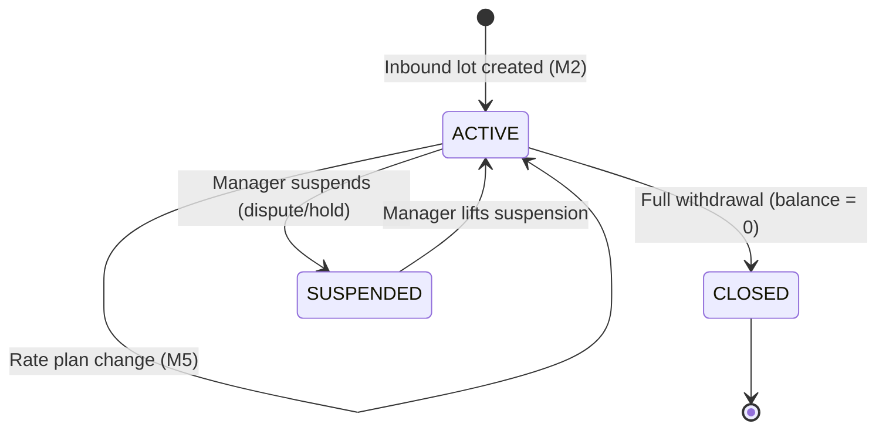

**Transitions & Rules:**

| From | To | Trigger | Business Rule |
|---|---|---|---|
| — | ACTIVE | Lot created at inbound | Must have owner, chamber, rate plan |
| ACTIVE | ACTIVE | Partial withdrawal | `current_balance -= qty`; balance must stay ≥ 0 |
| ACTIVE | ACTIVE | Ownership transfer | owner_party_id updated; ownership_history appended |
| ACTIVE | ACTIVE | Spoilage confirmed | `current_balance -= spoiled_qty`; MANAGER approval required |
| ACTIVE | CLOSED | Full withdrawal finalized | `current_balance = 0`; `closed_at = today` |
| ACTIVE | SUSPENDED | Manual hold by manager | No withdrawals or transfers allowed while suspended |
| SUSPENDED | ACTIVE | Manager lifts hold | All operations resume |

---

## 2. Invoice Lifecycle

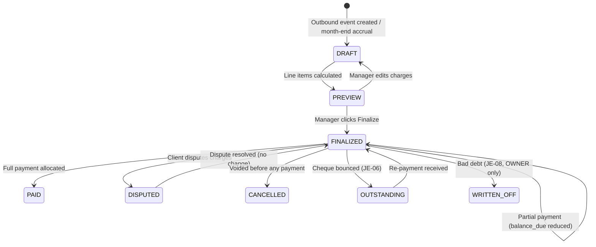

**Transitions & Rules:**

| From | To | Trigger | Business Rule |
|---|---|---|---|
| — | DRAFT | Outbound event created or month-end | No invoice_number yet |
| DRAFT | PREVIEW | Charges auto-calculated | Manager reviews before finalize |
| PREVIEW | FINALIZED | Manager finalizes | invoice_number assigned (INV-YYYYMM-NNNN); immutable; JE-01 posted |
| FINALIZED | PAID | `amount_paid = total` | All allocations complete |
| FINALIZED | DISPUTED | Client raises dispute | Credit note may follow |
| FINALIZED | CANCELLED | Voided (no payments yet) | Only if `amount_paid = 0` |
| FINALIZED | OUTSTANDING | Cheque dishonoured | JE-06 reverses payment; AR re-opened |
| FINALIZED | WRITTEN_OFF | OWNER writes off bad debt | JE-08 posted; OWNER only |

> **Immutability**: Once FINALIZED, the invoice record cannot be edited. Adjustments only via credit notes (JE-05).

---

## 3. Gate Pass Lifecycle

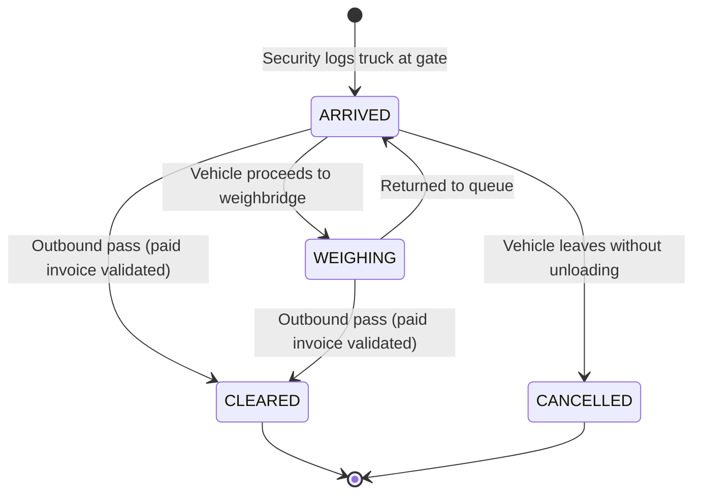

**Transitions & Rules:**

| From | To | Trigger | Business Rule |
|---|---|---|---|
| — | ARRIVED | Security logs vehicle (number, driver, bilty) | `pass_number` generated (GP-YYMMDD-NNNN) |
| ARRIVED | WEIGHING | Vehicle moves to scale area | Status update by operator |
| ARRIVED/WEIGHING | CLEARED | Security clears outbound | See *Release rules* below. `cleared_at` and `cleared_by` recorded. Turnaround time = `cleared_at - created_at` |
| ARRIVED | CANCELLED | Vehicle leaves without transaction | Manual cancellation by OPERATOR+ (not built yet) |

**Release rules (as built, fast-dispatch Phase 0 — `gate-pass.service.ts` `clearOutwardInternal`):**

1. **Which withdrawals are on the truck.** Normally *every* DISPATCHED withdrawal booked on the truck's plate that has not left yet (`gate_pass_id IS NULL`). Plates compare by letters and digits only (`normalizePlate`; `lhr 5234` = `LHR-5234`). There is no date cutoff, because a load dispatched days ago whose truck waited for a cheque to clear is still on the truck. Only withdrawals dispatched under these rules (`finalized_at` set) match by plate; one dispatched before them may already have left untracked.
2. **A named withdrawal** (`outbound_event_id`) is a MANAGER's call only. Naming one skips matching the rest of the load, so a non-manager could otherwise drive an unpaid booking out alongside a paid one. A named withdrawal must be DISPATCHED and not cancelled, must not have left on another truck, and must be booked on this plate; a blank plate on the booking counts as a mismatch. The MANAGER may release a plate mismatch with an `override_reason`.
3. **One truck per withdrawal.** Releasing a truck stamps `outbound_events.gate_pass_id` on every withdrawal it carries (conditionally, under row locks). A withdrawal already stamped, or named by another CLEARED pass, cannot clear a second truck.
4. **Nothing matched.** An empty or delivery truck (count 0, or no count) leaves freely, and the count it came in with is kept. A counted load that no withdrawal accounts for is held (`GATE_OUTWARD_UNMATCHED_LOAD`) unless a MANAGER overrides with a reason.
5. **No self-release.** Whoever booked or dispatched a withdrawal on the truck may not release it (MANAGER+ excepted).
6. **Payment.** A DRAFT invoice blocks release outright, even on credit, because a draft can still be edited. A pending (uncleared) cheque is not payment. The balance across all withdrawals must be ≤ Rs 0.01, or a MANAGER authorizes the release on credit. That authorization is stored on the pass (`credit_authorized_by/at/amount_pkr`). A party with a live standing credit approval (ceiling not exceeded, not lapsed or revoked; `docs/07`) needs no manager: the guard releases the truck alone, the preview shows READY with `on_credit`, and the pass stores `credit_approval_ids` and the approving manager in `credit_authorized_by`. A VOID invoice can never be re-issued (one invoice per withdrawal), so the stock leaves only on such a credit authorization; the amount is then recorded as unknown (null), never as Rs 0.
7. **Blind count.** When a withdrawal leaves, the guard's `declared_quantity` is required and must equal the bags dispatched. The error never states the expected number. A MANAGER may release a mismatch with an `override_reason`, and `quantity_mismatch_flag` stays raised.

---

## 4. Spoilage Record Lifecycle

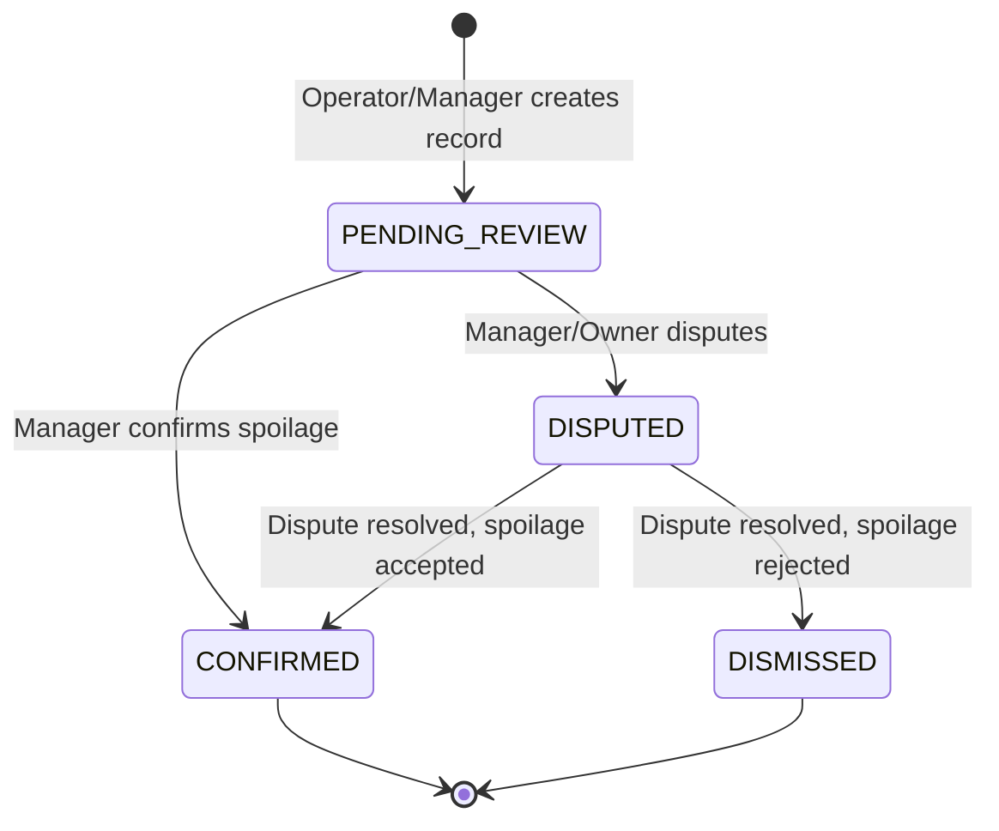

**Transitions & Rules:**

| From | To | Trigger | Business Rule |
|---|---|---|---|
| — | PENDING_REVIEW | Spoilage record created | Photos + cause required |
| PENDING_REVIEW | CONFIRMED | MANAGER+ confirms | `lot.current_balance -= quantity_affected`; owner notified; JE-09 if cold store liable |
| PENDING_REVIEW | DISPUTED | MANAGER+ disputes finding | `dispute_note` required; lot qty NOT changed |
| DISPUTED | CONFIRMED | Resolution: spoilage accepted | Same effects as direct confirmation |
| DISPUTED | DISMISSED | Resolution: no spoilage | Record archived; no lot adjustment |

---

## 5. Payment Lifecycle

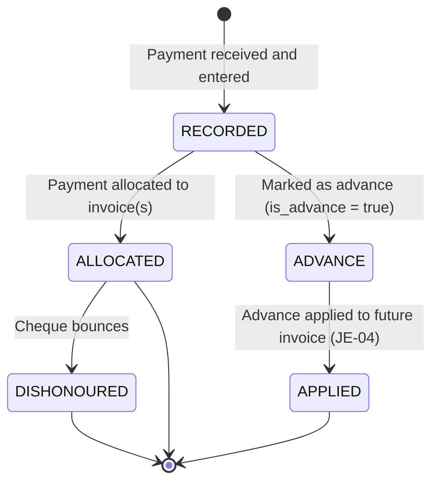

**Transitions & Rules:**

| From | To | Trigger | Business Rule |
|---|---|---|---|
| — | RECORDED | Accountant records payment | JE-02 (normal) or JE-03 (advance) |
| RECORDED | ALLOCATED | Payment linked to invoice(s) via allocations | Updates `invoice.amount_paid` |
| RECORDED | ADVANCE | `is_advance = true`, no invoice exists yet | Amount posted to liability account 2010 |
| ALLOCATED | DISHONOURED | Cheque bounces after clearance | JE-06 reversal; AR re-opened; party flagged |
| ADVANCE | APPLIED | Invoice finalized with advance offset | JE-04 (DR 2010 / CR Receivable) |

---

## 6. Outbound Event Lifecycle

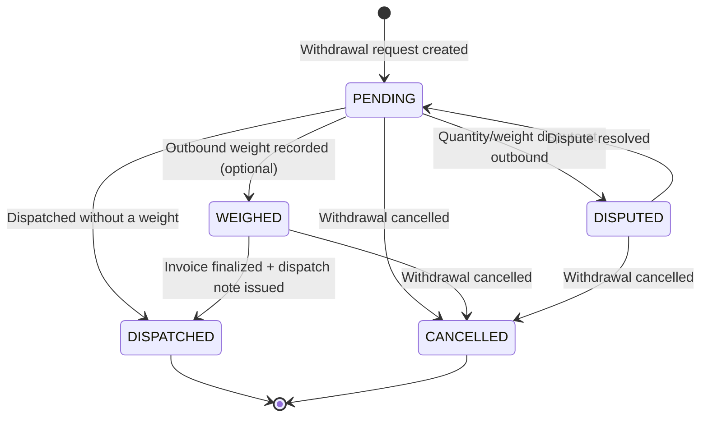

**Transitions & Rules:**

| From | To | Trigger | Business Rule |
|---|---|---|---|
| — | PENDING | Operator creates withdrawal request | `qty <= lot.current_balance − bags held by open (PENDING/WEIGHED/DISPUTED) withdrawals` (`LOT_BALANCE_RESERVED`); FULL only when nothing else is open. Below MANAGER, `outbound_date` may not be after today (Lahore calendar) |
| PENDING | WEIGHED | Outbound weight entered (optional, docs/27) | Weight variance displayed. A single conditional UPDATE, so it can never revert a DISPATCHED withdrawal |
| PENDING or WEIGHED | DISPATCHED | Dispatched by `outbound.finalize` (MANAGER by default). Weight is optional (docs/27): `isReadyToDispatch()` is the one rule, used by finalize, both checkouts and the solo door | Withdrawal then lot row-locked, the lot re-read under the lock: it must be ACTIVE, a FULL must still equal the balance, the balance stays ≥ 0 (DB CHECK too). Lot balance updated; DRAFT invoice built; `finalized_by/at` stamped. JE-01 posts when the invoice is finalized |
| PENDING/WEIGHED/DISPUTED | CANCELLED | `POST /v1/outbound-events/:id/cancel` (`outbound.record`, reason required) | Lot balance unchanged; its bags are free again. `voided_at/by`, `void_reason` set. No dispatch note can be printed for it. Refused (`OUTBOUND_ALREADY_LEFT`) if a truck already carried it out, which the old gate allowed before dispatch |
| PENDING | DISPUTED | Quantity dispute at outbound | Lot qty held; note required (never built: nothing sets DISPUTED). A legacy DISPUTED row cannot be dispatched (`OUTBOUND_DISPUTED`) and holds its truck (`TRUCK_NOT_READY`) until cancelled |

The **dispatch desk** drives PENDING or WEIGHED → DISPATCHED through `POST /v1/outbound-events/:id/dispatch-and-collect` (`DispatchCheckoutService`), which composes `finalizeInTransaction`, the bill's default service lines, `InvoiceService.finalizeInTransaction` (JE-01) and, unless on credit, `PaymentService.recordInTransaction` (JE-02) in one transaction. The bill is therefore never left as a DRAFT by this path, and a failure at any step (including the receipt) leaves the withdrawal as it was (PENDING or WEIGHED) with nothing posted. The older Finalize & Dispatch (DRAFT bill) remains for the withdrawal page. The same transition is open to the munshi alone when the owner's solo switch is on and the truck is clean (cash in full, or credit a standing approval covers); the stage flow and the all-or-nothing rule are unchanged, only who may press the button.

An ownership transfer also respects open withdrawals. A PARTIAL transfer may take only the free bags. A FULL transfer waits until no withdrawal is open, because the open withdrawal would release goods to the previous owner.

---

## 7. Credit Note Lifecycle

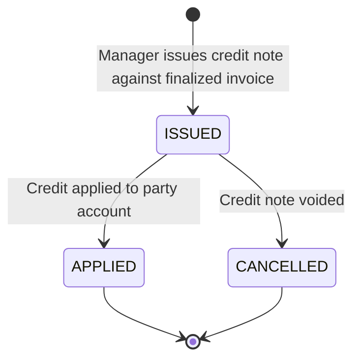

**Transitions & Rules:**

| From | To | Trigger | Business Rule |
|---|---|---|---|
| — | ISSUED | MANAGER+ issues against finalized invoice | `total <= original invoice total`; JE-05 posted (DR Revenue / CR Receivable) |
| ISSUED | APPLIED | System applies to party balance | Reduces AR; if overpaid, excess → advance liability (2010) |
| ISSUED | CANCELLED | Voided before application | Reversal JE posted |

---

## 8. Journal Entry Lifecycle

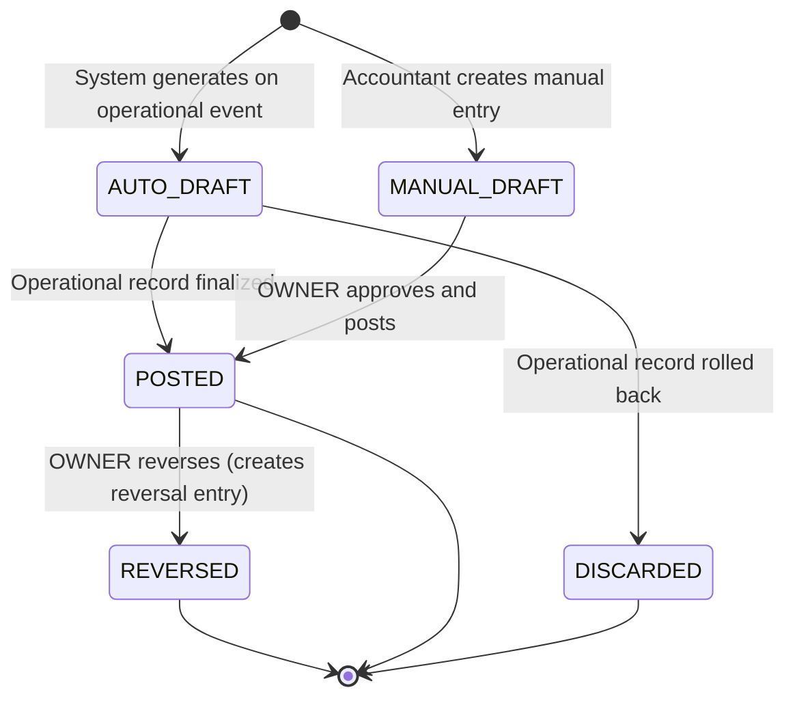

**Transitions & Rules:**

| From | To | Trigger | Business Rule |
|---|---|---|---|
| — | AUTO_DRAFT | Operational event fires (invoice, payment, etc.) | Balanced debit/credit required |
| AUTO_DRAFT | POSTED | Source record finalized | Atomically committed with operational record |
| AUTO_DRAFT | DISCARDED | Source record fails validation | No orphan JEs in GL |
| — | MANUAL_DRAFT | Accountant creates (depreciation, salary accrual) | Balanced lines required |
| MANUAL_DRAFT | POSTED | OWNER approves | period must be unlocked |
| POSTED | REVERSED | OWNER reverses | Creates new JE with swapped debits/credits; references original |

> **Immutability**: POSTED entries cannot be UPDATE'd or DELETE'd. Only reversals.

---

## 9. Expense Voucher Lifecycle

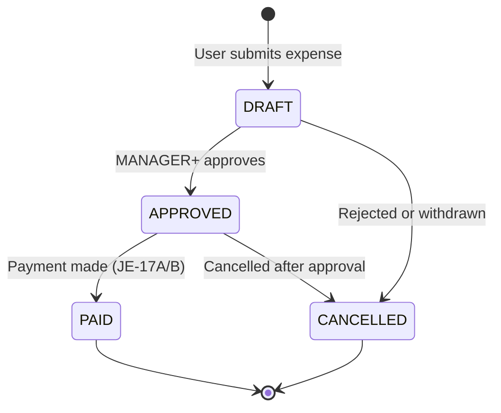

---

## 10. Fixed Asset Lifecycle

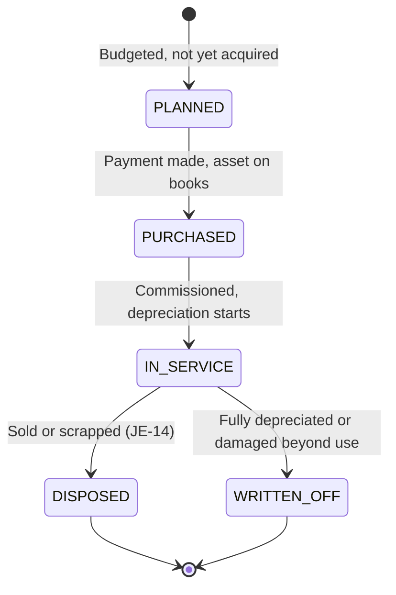

---

## 11. Party Loan (Peshgi) Lifecycle

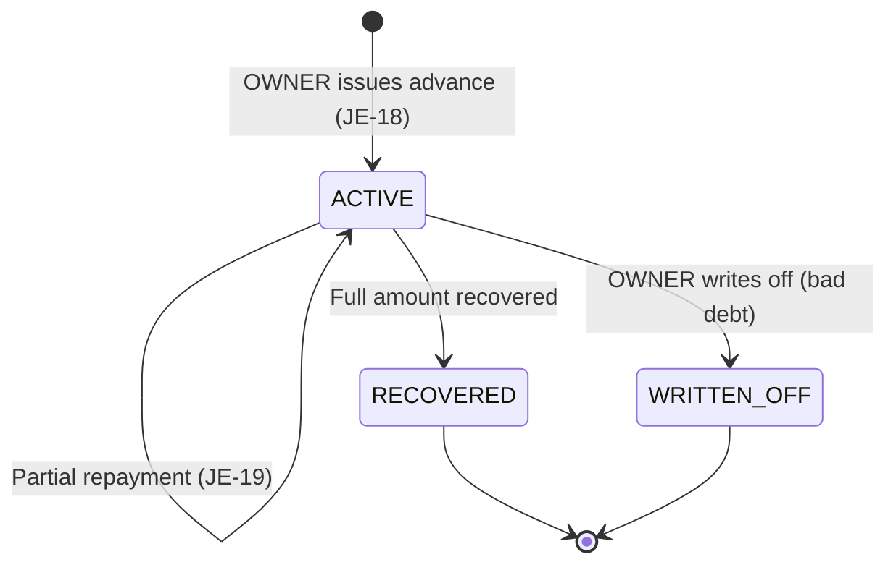

---

## 12. Payroll Run Lifecycle

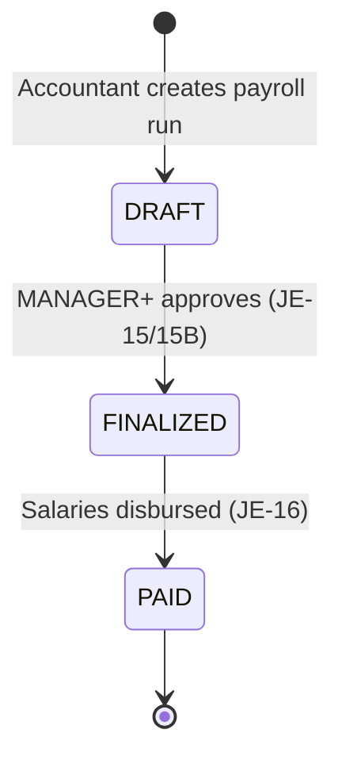
